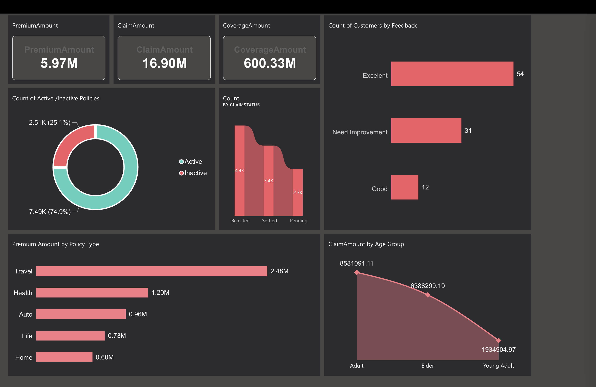
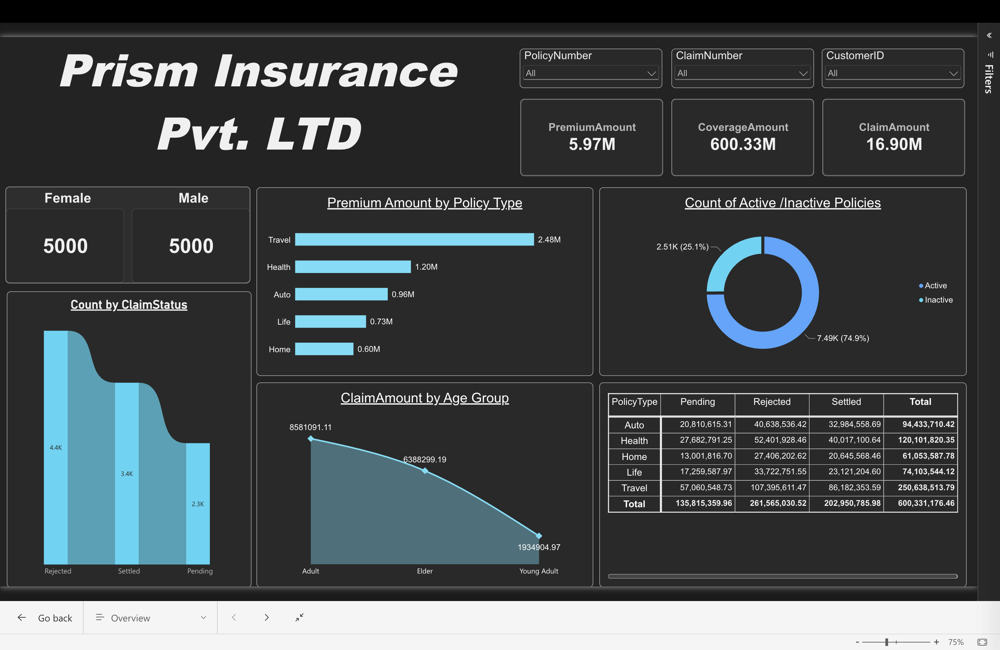
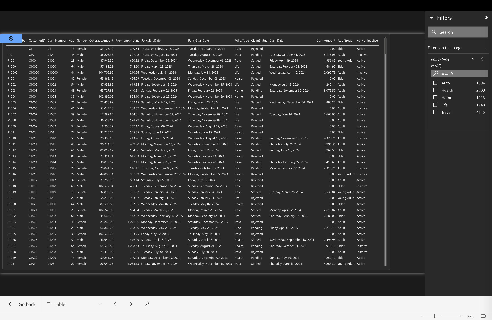
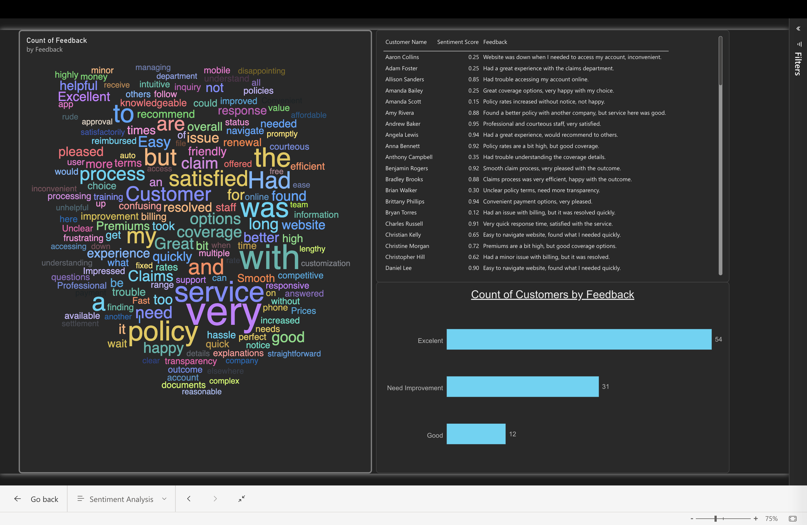

<H1 align="Center">
Insurance Data Analysis Report
</H1>

<H3 align="center">
Dashboard Link
  <a href="https://app.powerbi.com/groups/me/dashboards/306ea58b-2b8e-4315-adf1-41c67f6bb5ac?ctid=bd5f40b7-f64c-4225-8b0d-c515ce5e13d8&pbi_source=linkShare">
    
  </a>
</H3>

## Problem Statement

This dashboard helps an insurance company (Prism Insurance Pvt. Ltd.) understand its policy portfolio, claims and customer feedback in one place. It shows how much premium is collected, how much coverage is provided and how much is claimed, which policy types and age groups drive the most premium and claims, how many policies are active or inactive, and how customers feel about the service through feedback and sentiment scores.

By identifying the policy types, age groups and claim statuses that need attention, and the areas customers are unhappy with, the business can price policies better, keep claim amounts under control, retain customers and improve its service.

### Repository Contents

| File | Description |
|------|-------------|
| `Insurance_Data_Analysis.pbix` | The Power BI report (data model + 3 report pages) |
| `PBI_Project_2.pbix` | Power BI file containing the data model only (no report pages) |
| `README.md` | Project documentation (this file) |

> **Report Link:** https://app.powerbi.com/links/o1xL3e3c1v?ctid=bd5f40b7-f64c-4225-8b0d-c515ce5e13d8&pbi_source=linkShare

### Steps followed

- Step 1 : Load the insurance dataset into Power BI Desktop. The model contains two tables: `InsuranceData` (policies, customers and claims) and `Sentiment Scores` (customer feedback).
- Step 2 : Open Power Query Editor and check "column quality", "column distribution" and "column profile" (based on the entire dataset) to look for errors and empty values before loading.
- Step 3 : Create a calculated column `Age Group` in `InsuranceData` to group customers into age bands (paste your DAX below).
- Step 4 : Create the `Active /Inactive` field in `InsuranceData` to flag whether a policy is currently active (paste your DAX / logic below).
- Step 5 : In the report view, set the page size (1920 x 1080) and apply a theme.
- Step 6 : **Overview page**
  - A text box shows the company name, `Prism Insurance Pvt. Ltd`.
  - Three card visuals show the total `PremiumAmount`, total `ClaimAmount` and total `CoverageAmount`.
  - A bar chart `Premium Amount by Policy Type` compares premium across policy types.
  - A line chart `ClaimAmount by Age Group` shows how claims vary with customer age.
  - A donut chart `Count of Active /Inactive Policies` shows the share of active and inactive policies.
  - A ribbon chart shows the count of claims by `ClaimStatus`.
  - A matrix shows total `CoverageAmount` by `PolicyType` (rows) and `ClaimStatus` (columns).
  - A card broken down by `Gender` shows customer information by gender.
  - Visual filters (slicers) were added for `ClaimNumber`, `CustomerID` and `PolicyNumber`.
- Step 7 : **Table page** - A table lists every record with these fields: Customer ID, Gender, Age, Age Group, Policy Number, Policy Type, Policy Start Date, Policy End Date, Active / Inactive, Premium Amount, Coverage Amount, Claim Number, Claim Date, Claim Amount and Claim Status. A Back button returns the user to the previous page.
- Step 8 : **Sentiment Analysis page**
  - A bar chart `Count of Customers by Feedback` shows the number of customers in each feedback `Quality` category.
  - A word cloud visual (added from the visuals marketplace using the three ellipses in the Visualizations pane) shows the most common words in customer `Feedback`.
  - A table lists `Customer Name`, `Feedback` and `Sentiment Score` for each customer.
- Step 9 : The report was then published to Power BI Service.

DAX / logic used (paste your own below):

```dax
Age Group = <your DAX>
```

```dax
Active /Inactive = <your DAX>
```

# Snapshot of Dashboard 


# Report Snapshot 





# Insights

A three-page report was created on Power BI Desktop & it was then published to Power BI Service.

Following inferences can be drawn from the dashboard (fill in the values from your report);

### [1] Key Totals

    Total Premium Amount  = <value>
    Total Claim Amount    = <value>
    Total Coverage Amount = <value>

### [2] Premium by Policy Type

    <policy type> - <value>
    <policy type> - <value>

        thus, <policy type> brings in the highest premium.

### [3] Claims by Age Group

    <age group> - <value>
    <age group> - <value>

        thus, customers in the <age group> age group claim the most.

### [4] Policy Status

    Active policies   = <value> (<%>)
    Inactive policies = <value> (<%>)

### [5] Claim Status

    <claim status> - <count>
    <claim status> - <count>

### [6] Coverage by Policy Type and Claim Status

    <describe the pattern seen in the matrix>

### [7] Customer Sentiment

    a) Customers by feedback quality - <value>
    b) Most common words in feedback  - <words from the word cloud>
    c) Overall sentiment              - <positive / neutral / negative>

Values on the report will change if different visual filters are applied.

---

## Notes & Possible Improvements

- The card showing customers by gender currently aggregates `CustomerID` with a Min; a distinct count of customers would give the number of customers per gender.
- The word cloud is a custom visual, so it needs to be available in Power BI Desktop / Service to render.
- `PBI_Project_2.pbix` has no report pages. Remove it from the repo if it is only a duplicate of the model in `Insurance_Data_Analysis.pbix`.